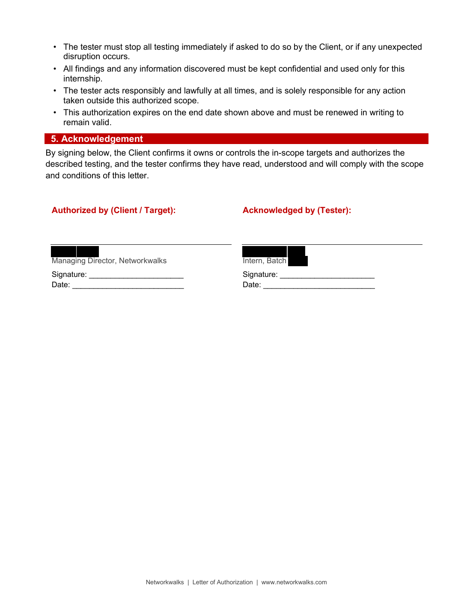
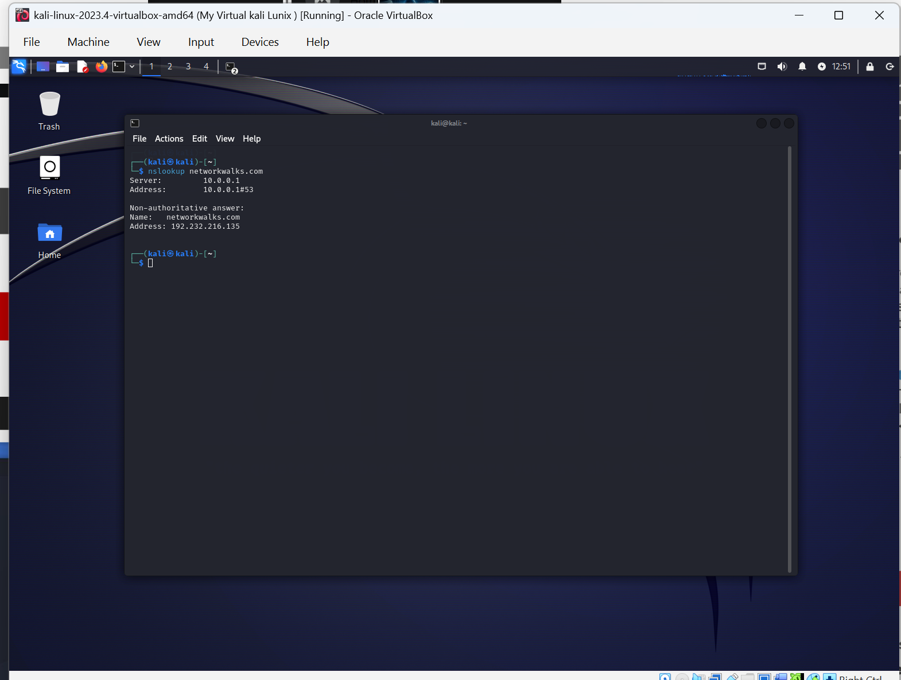
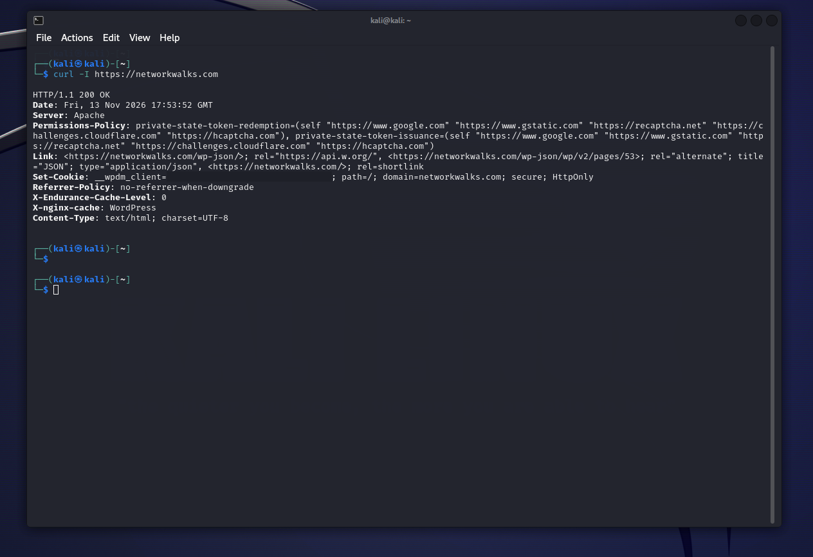
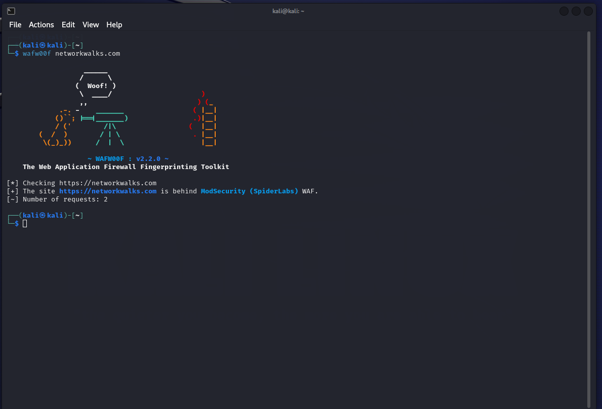
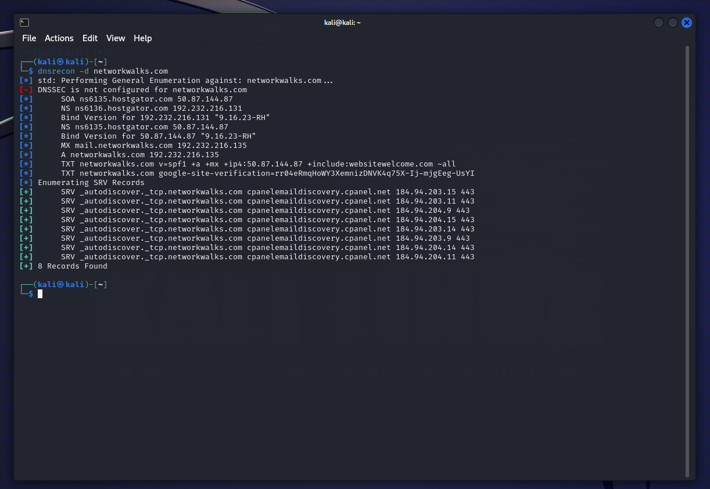

## NETWORKWALKS-BLEN-B084-WK2-PM1-FOOTPRINTING-AND-RECONNAISSANCE

Week 2 Cybersecurity Lab using Kali Linux and VirtualBox.

## Project overview

This project documents six reconnaissance steps for the Networkwalks lab.

## Lab Components

- Oracle VirtualBox
- Kali Linux
- WHOIS, WhatWeb, nslookup, curl, WAFW00F, and DNSRecon

## Sample permission letter

This is a sample permission letter for the lab.

## Lab steps

1. **Review domain registration with WHOIS**

   I checked the website’s domain records to see which name servers were listed.

   

   [Terminal output](evidence/01-whois.txt)

2. **Identify web technologies with WhatWeb**

   I checked which tools and software the website uses. The results showed Apache and WordPress.

   

   [Terminal output](evidence/02-whatweb.txt)

3. **Resolve the domain with nslookup**

   I looked up the IP address that the website name points to.

   

   [Terminal output](evidence/03-nslookup.txt)

4. **Inspect HTTP response headers with curl**

   I checked how the website responds. It redirected the first request to the secure HTTPS address, which loaded successfully.

   

   [Terminal output](evidence/04-curl.txt)

5. **Check for a web application firewall with WAFW00F**

   I checked for a web firewall. The tool reported ModSecurity.

   

   [Terminal output](evidence/05-wafw00f.txt)

6. **Review DNS records with DNSRecon**

   I checked the website’s DNS records to see where web and email traffic are sent.

   

   [Terminal output](evidence/06-dnsrecon.txt)
