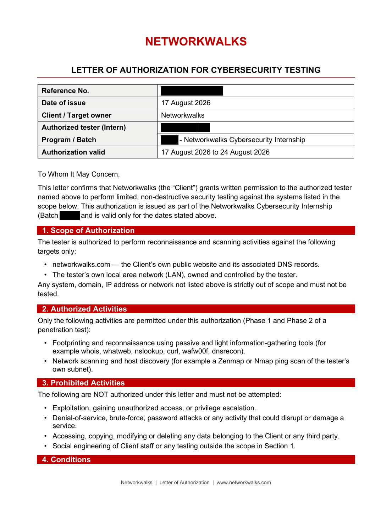
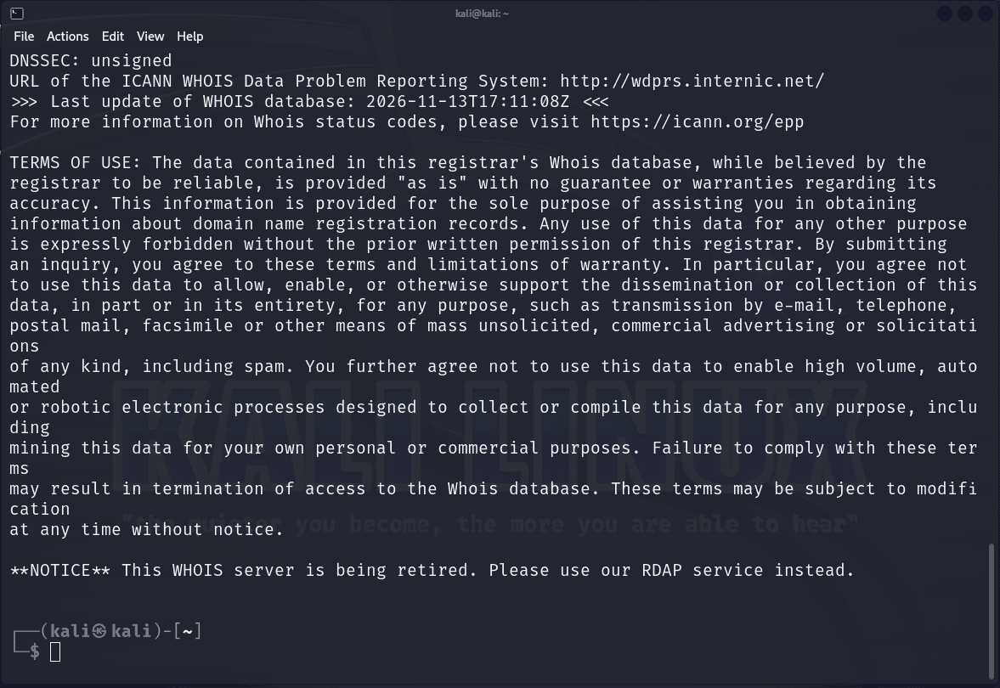
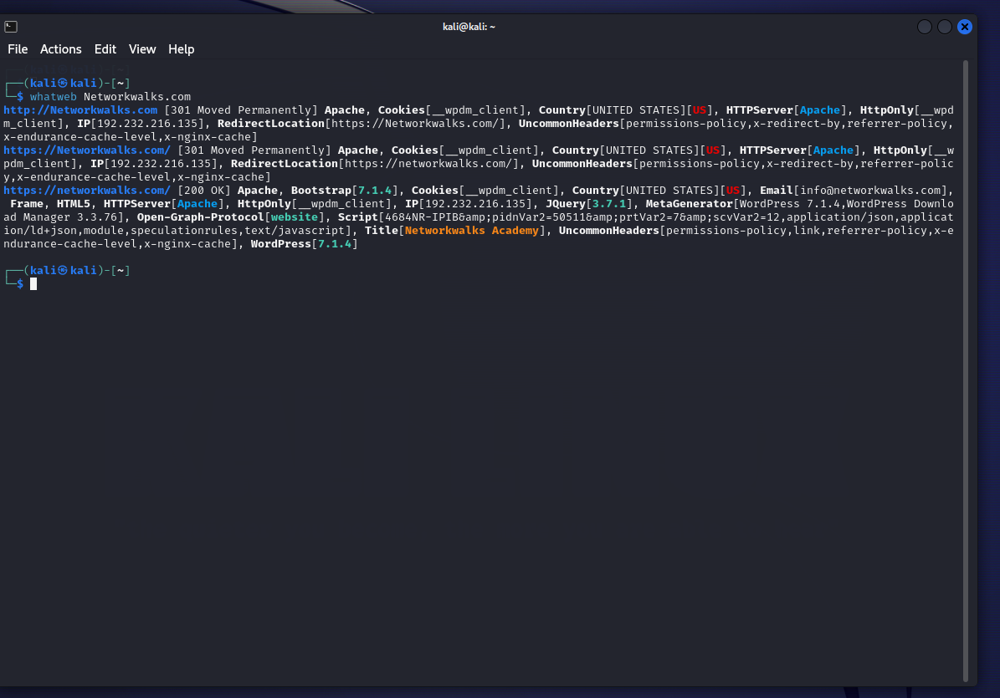

## NETWORKWALKS-BLEN-B084-WK2-PM1-FOOTPRINTING-AND-RECONNAISSANCE

Week 2 Cybersecurity Lab using Kali Linux and VirtualBox.

## Project overview

This project documents six reconnaissance steps for the Networkwalks lab.

## Lab Components

- Oracle VirtualBox
- Kali Linux
- WHOIS, WhatWeb, nslookup, curl, WAFW00F, and DNSRecon

## Sample permission letter

The unsigned sample lists August 17–24, 2026. The lab output includes November 12–13, 2026. Names, the reference number, and the batch identifier are redacted.

## Lab steps

1. **Review domain registration with WHOIS**

   The WHOIS excerpt listed four name servers: `NS6135.HOSTGATOR.COM`, `NS6136.HOSTGATOR.COM`, `NS29.DOMAINCONTROL.COM`, and `NS30.DOMAINCONTROL.COM`. It showed unsigned DNSSEC and a notice directing users to RDAP. The excerpt lacks the registrar and the domain creation and expiration dates.

   

   [Terminal output](evidence/01-whois.txt)

2. **Identify web technologies with WhatWeb**

   WhatWeb showed two `301 Moved Permanently` responses before the final HTTPS URL returned `200 OK`. The final response was titled **Networkwalks Academy**. The tool reported Apache, WordPress, WordPress Download Manager, and jQuery.

   

   [Terminal output](evidence/02-whatweb.txt)

3. **Resolve the domain with nslookup**

   The local DNS resolver at `10.0.0.1` returned a non-authoritative IPv4 answer of `192.232.216.135` for the domain.

   

   [Terminal output](evidence/03-nslookup.txt)

4. **Inspect HTTP response headers with curl**

   The HTTP HEAD request returned `301 Moved Permanently` with `Location: https://networkwalks.com/`. The HTTPS HEAD request returned `HTTP/1.1 200 OK`. The response advertised Apache in the `Server` header and WordPress in the `X-nginx-cache` header. The `Link` header referenced the WordPress REST API. The response set a cookie with the `Secure` and `HttpOnly` attributes. The cookie value is redacted in the screenshot.

   

   [Terminal output](evidence/04-curl.txt)

5. **Check for a web application firewall with WAFW00F**

   WAFW00F reported **ModSecurity (SpiderLabs)** after two requests. This is the tool’s fingerprinting result.

   

   [Terminal output](evidence/05-wafw00f.txt)

6. **Review DNS records with DNSRecon**

   DNSRecon returned the same IPv4 address as nslookup. It listed two HostGator name servers, a mail exchanger, TXT records for SPF and site verification, and cPanel mail autodiscovery results. DNSRecon reported that DNSSEC was unconfigured.

   

   [Terminal output](evidence/06-dnsrecon.txt)
