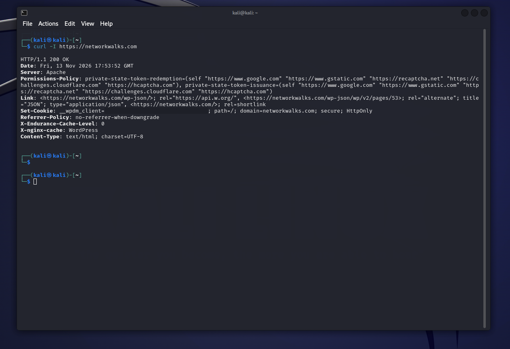

# Penetration Testing Report

**Footprinting and Network Scanning Phases**  
**W2-PM-FINAL | Cybersecurity | NetworkWalks**

| Field | Details |
|---|---|
| Portfolio | Blen-Kesete-IT |
| Program / batch | NetworkWalks Cybersecurity, B084 as recorded in the PM1 repository |
| Modules | [W2-PM1](https://github.com/Blen-Kesete-IT/networkwalks-week-2-recon), [W2-PM2](https://github.com/Blen-Kesete-IT/GHDB-Footprinting-lab), [W2-PM3](https://github.com/Blen-Kesete-IT/Maltego-Footprinting-lab), [W2-PM4](https://github.com/Blen-Kesete-IT/TheHarvester-footprinting-lab), [W2-PM5](https://github.com/Blen-Kesete-IT/zenmap-network-discovery-lab) |
| Phases covered | Reconnaissance, footprinting, scanning, and network discovery |
| Scope | Course-domain observations, supplied public-source evidence, and local Wi-Fi discovery |

## 1. Liability Disclaimer

This report documents educational labs. The PM1 repository includes a sample permission letter. Testing scope and authorization should be confirmed before running any active assessment. The findings are observations from the recorded exercises. Vulnerability validation and exploitation were outside the reported scope.

## 2. Introduction

This report combines five Week 2 labs. PM1 through PM4 cover domain records, indexed web interfaces, relationship mapping, and search-source output. PM5 covers live-host discovery on a local Wi-Fi network.

## 3. Tools Used

| Module | Tools | Purpose |
|---|---|---|
| [W2-PM1](https://github.com/Blen-Kesete-IT/networkwalks-week-2-recon) | Kali Linux, WHOIS, WhatWeb, nslookup, curl, WAFW00F, DNSRecon | Review registration, DNS, HTTP behavior, and reported web technologies |
| [W2-PM2](https://github.com/Blen-Kesete-IT/GHDB-Footprinting-lab) | Google Hacking Database | Review evidence of indexed camera interfaces |
| [W2-PM3](https://github.com/Blen-Kesete-IT/Maltego-Footprinting-lab) | Maltego Graph Desktop | Document a domain-to-contact relationship |
| [W2-PM4](https://github.com/Blen-Kesete-IT/TheHarvester-footprinting-lab) | theHarvester 4.4.4 | Compare search-source results and errors |
| [W2-PM5](https://github.com/Blen-Kesete-IT/zenmap-network-discovery-lab) | Windows IP configuration, Zenmap | Identify the local subnet and interpret host discovery |

## 4. Activities Performed

### 4.1 Footprinting and Reconnaissance

- **PM1.** WHOIS and DNSRecon supplied domain and DNS information. WhatWeb reported Apache and WordPress. The HTTP request redirected to HTTPS. WAFW00F reported ModSecurity. The DNS lookup and DNSRecon agreed on the address observed in the lab.
- **PM2.** The worksheet recorded ten references. A captured camera interface showed multiple images during a signed-out session. Access configuration and current availability remain unverified.
- **PM3.** The Maltego graph showed two entities and one link between the course domain and its publicly listed organization contact address.
- **PM4.** DuckDuckGo returned 27 raw host entries, zero IP addresses, and zero email addresses. The list included apparent duplicates and malformed entries. Baidu produced disconnections, and the multi-source run showed missing API-key warnings and source errors.

### 4.2 Network Scanning with Zenmap

The selected Quick Scan checked 256 addresses on the local Wi-Fi subnet and reported **3 hosts up**. These were the gateway, the scanning Windows computer, and one other device. Zenmap reported MAC addresses for the remote devices, and Windows IP configuration supplied the local computer’s MAC address. The topology view also contained an address from a different subnet. The selected scan summary establishes the count for this exercise.

## 5. Risk Analysis / Impact

| Observation | Potential impact | Assessment |
|---|---|---|
| Public web and DNS metadata | Reveals technologies and infrastructure relationships | Informational |
| Camera interface visible during a signed-out session | May expose imagery if access was unintended | Review access controls |
| Public organization contact in Maltego | Public contact information can be reused in unsolicited outreach | Informational |
| Raw host entries and source errors | Duplicate or malformed data could inflate an inventory | Data quality issue |
| Three hosts visible on the local subnet | Discovery can identify devices for inventory reconciliation | Informational |

## 6. Recommendations

- Review public-facing metadata and maintain current web software.
- Confirm that camera access matches the intended audience.
- Deduplicate and validate search results before including them in an asset inventory.
- Compare local discovery results with known devices and keep network documentation current.

## 7. Conclusion

The labs demonstrated how to collect and compare observations across public records, search results, and local network discovery. The selected Zenmap output established the live-host count, while the footprinting labs showed how source coverage and data quality affect what can be concluded.

## 8. Evidence Collected

### PM1 · Kali reconnaissance

### PM2 · GHDB

### PM3 · Maltego

### PM4 · theHarvester

### PM5 · Zenmap

The [Zenmap evidence summary](https://github.com/Blen-Kesete-IT/zenmap-network-discovery-lab/blob/main/README.md#evidence) records 256 addresses checked and 3 hosts up. It also explains the additional address in the topology view.

## Course Credit

NetworkWalks and Waqas Karim CCIE provided the lab guidance.
