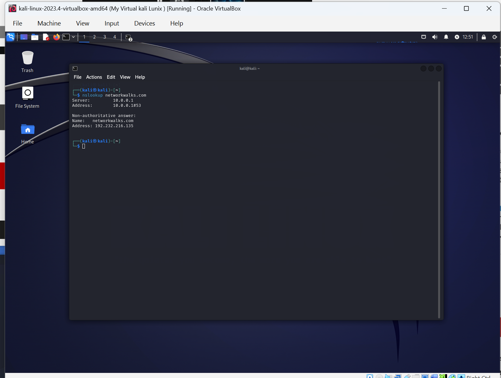

# PENETRATION TESTING REPORT
## FOOTPRINTING & NETWORK SCANNING PHASES
**W2-PM-FINAL | CYBERSECURITY | NETWORKWALKS**

| | |
|---|---|
| **Pentester Name (Cybersecurity Professional)** | Blen Kesete |
| **Program/Batch** | B084 – NetworkWalks |
| **Date** | |
| **Modules completed** | W2-PM1 (Multiple Kali Tools) W2-PM2 (GHDB Footprinting) W2-PM3 (Maltego Footprinting) W2-PM4 (theHarvester Footprinting) W2-PM5 (Zenmap Scanning) |
| **Client/Target** | 1. NetworkWalks course domain 2. My own local LAN network 3. Public-source results reviewed in PM2 and PM4 |
| **Permission secured from client?** | PM1 repository includes a sample permission letter. Written approval is unverified. PM5 used my own local network. |
| **Phases covered** | Phase 1: Reconnaissance & Footprinting Phase 2: Scanning & Network Discovery |

## 1. Liability Disclaimer

This report documents educational cybersecurity exercises. Active testing requires permission from the system owner and an agreed scope. The report records observations from footprinting and host discovery.

## 2. Introduction

This report covers my Week 2 NetworkWalks labs. I used Kali Linux for domain footprinting and search-source comparison, Maltego on Windows to map a relationship, and Zenmap on Windows to discover live hosts on my local Wi-Fi network. The screenshots in Section 8 show the evidence available from the module repositories.

## 3. Tools Used

| Tool | Purpose |
|---|---|
| Kali Linux & Windows | Operating systems used for the labs |
| WHOIS | Review domain registration and name servers |
| WhatWeb | Identify web technologies |
| nslookup | Resolve a domain name using DNS |
| curl | Inspect HTTP responses and redirects |
| WAFW00F | Identify signs of a web application firewall |
| DNSRecon | Review DNS and mail records |
| Google Hacking Database | Review indexed web-interface evidence |
| Maltego Graph Desktop | Visualize the relationship between a domain and a public contact |
| theHarvester | Compare search-source output |
| Zenmap (Nmap GUI) | Discover live hosts and view topology |
| Windows CMD | Check local IP and MAC information |

## 4. Activities Performed

### 4.1 Footprinting & Reconnaissance

**W2-PM1 — Multiple Kali Tools.** I used WHOIS to review domain registration and name servers. WhatWeb reported Apache and WordPress. I resolved the domain with nslookup, and DNSRecon returned the same address while also showing DNS and mail information. Curl showed an HTTP-to-HTTPS redirect. WAFW00F reported ModSecurity.

**W2-PM2 — GHDB.** I explored Google search operators (`intitle:`, `inurl:`, `site:`, and `filetype:`), documented ten Insecam camera listing references and ten mathematics PDF resources or collections, and organized the exercise into three parts: GHDB methodology, camera footprinting, and mathematics PDF footprinting. I reported viewing camera feeds through the listing pages; their current availability and access configuration were not independently verified. The mathematics results include university notes, open textbook pages, and catalogs. My [GHDB lab report](https://github.com/Blen-Kesete-IT/GHDB-Footprinting-lab) contains the clickable finding tables and explanations.

**W2-PM3 — Maltego.** The graph showed two entities and one link connecting the course domain to its publicly listed organization contact.

**W2-PM4 — theHarvester.** DuckDuckGo returned 27 raw host entries, zero IP addresses, and zero email addresses. Some entries appeared duplicated or malformed. The Baidu run reported server disconnections, and the multi-source run showed missing API-key warnings and source errors.

### 4.2 Network Scanning with Zenmap

I used Windows IP configuration to identify my local subnet. The selected Zenmap **Quick Scan** checked 256 addresses on my local Wi-Fi subnet and reported **3 hosts up**. The hosts were the gateway, my Windows computer, and one other device. Zenmap showed MAC addresses for the two remote devices. Windows IP configuration supplied my computer’s MAC address.

The topology view showed an additional address from a different subnet. I used the selected scan summary to confirm the count for this lab.

### 4.3 GHDB Footprinting — Three-Part Lab Findings

| Part | Activity | Findings and learning |
|---|---|---|
| 1 — GHDB methodology | Reviewed search operators and GHDB screenshot evidence | Learned how public indexing can help with passive reconnaissance without proving a vulnerability |
| 2 — Camera listings | Recorded ten clickable Insecam references; reviewed the existing webcam interface screenshot | Student-reported access to listing feeds highlights possible privacy risks; device addresses and credentials were not collected |
| 3 — Mathematics PDFs | Recorded ten entries for public PDF directories, lecture notes, and open textbooks | Learned to distinguish directory indexes from intentionally published educational resources; some textbook entries share a catalog page |

[View the complete GHDB footprinting findings, hyperlinks, and existing screenshots](https://github.com/Blen-Kesete-IT/GHDB-Footprinting-lab#part-1--ghdb-and-footprinting-method)

### 4.4 Expanded PM2 GHDB Findings and Screenshot Evidence

This section adds details from the [GHDB Footprinting Lab](https://github.com/Blen-Kesete-IT/GHDB-Footprinting-lab) to the existing Week 2 report without replacing the earlier modules or screenshots.

**Part 1 — GHDB method.** I reviewed search operators such as `intitle:`, `inurl:`, `site:`, and `filetype:` to study information indexed by search engines. A search result by itself does not prove a security vulnerability.

**Part 2 — Camera footprinting.** I recorded ten Insecam listing references and reported viewing camera feeds during the exercise. The listing IDs are not camera IP addresses, and the feeds' current accessibility or security settings have not been independently confirmed.

The screenshot above is an existing interface capture, not proof of ten individually photographed camera listings.

### Camera findings table

| No. | Clickable camera listing | Observation | Username / Password |
|---|---|---|---|
| 1 | [Insecam listing 1012712](http://www.insecam.org/en/view/1012712/) | Student-reported visible feed; not independently verified | Not supplied |
| 2 | [Insecam listing 1012784](http://www.insecam.org/en/view/1012784/) | Student-reported visible feed; not independently verified | Not supplied |
| 3 | [Insecam listing 1012770](http://www.insecam.org/en/view/1012770/) | Student-reported visible feed; not independently verified | Not supplied |
| 4 | [Insecam listing 1012776](http://www.insecam.org/en/view/1012776/) | Student-reported visible feed; not independently verified | Not supplied |
| 5 | [Insecam listing 1012769](http://www.insecam.org/en/view/1012769/) | Student-reported visible feed; not independently verified | Not supplied |
| 6 | [Insecam listing 1012766](http://www.insecam.org/en/view/1012766/) | Student-reported visible feed; not independently verified | Not supplied |
| 7 | [Insecam listing 1012760](http://www.insecam.org/en/view/1012760/) | Student-reported visible feed; not independently verified | Not supplied |
| 8 | [Insecam listing 1012752](http://www.insecam.org/en/view/1012752/) | Student-reported visible feed; not independently verified | Not supplied |
| 9 | [Insecam listing 1012735](http://www.insecam.org/en/view/1012735/) | Student-reported visible feed; not independently verified | Not supplied |
| 10 | [Insecam listing 1012730](http://www.insecam.org/en/view/1012730/) | Student-reported visible feed; not independently verified | Not supplied |

**Relevant query (illustrative, not a verified GHDB entry):** `site:insecam.org/en/view/ "IP camera"`

**Our findings:** Ten listings were documented, and the student reports having viewed camera feeds. Current accessibility, authorization, and underlying camera security settings were not confirmed. Public camera viewing can create privacy and information exposure risks.

**What we learned:** A publicly listed endpoint or page is not the same as proof of a vulnerable device. Good footprinting distinguishes user observations, screenshots, credentials, and verified technical findings.

**Part 3 — Mathematics PDF footprinting.** I collected ten entries representing open mathematics resources, university lecture notes, directories, and publishers' catalogs, with relevant search queries.

## Footprinting findings

| No. | PDF resource / listing | Relevant Google dork | Username / Password (if any) | Observation |
|---|---|---|---|---|
| 1 | [Skyline University mathematics directory](https://www.skylineuniversity.ac.ae/pdf/math/) | `intitle:index.of "parent directory" mathematics pdf` | — | Instructor's directory-listing example |
| 2 | [UW–Madison free lecture notes](https://people.math.wisc.edu/~angenent/Free-Lecture-Notes/) | `site:wisc.edu mathematics "PDF" "calculus"` | None indicated | Public lecture-note collection |
| 3 | [UW–Madison Elementary Calculus](https://people.math.wisc.edu/~hkeisler/calc.html) | `site:wisc.edu "Elementary Calculus" pdf` | None indicated | Open mathematics textbook page |
| 4 | [American Institute of Mathematics open textbooks](https://textbooks.aimath.org/textbooks/approved-textbooks/) | `site:aimath.org "open textbooks" pdf` | None indicated | Curated open-textbook collection |
| 5 | [OpenStax College Algebra 2e](https://openstax.org/books/college-algebra-2e/pages/preface) | `site:openstax.org "College Algebra 2e" pdf` | None indicated | Free textbook page with PDF option |
| 6 | [OpenStax Precalculus 2e](https://openstax.org/books/precalculus-2e/pages/preface) | `site:openstax.org "Precalculus 2e" pdf` | None indicated | Free textbook page with PDF option |
| 7 | [OpenStax Introductory Statistics 2e](https://openstax.org/books/introductory-statistics-2e/pages/1-introduction) | `site:openstax.org "Introductory Statistics 2e" pdf` | None indicated | Free textbook page with PDF option |
| 8 | [OpenStax Calculus Volume 1](https://openstax.org/subjects/math) | `site:openstax.org "Calculus Volume 1" pdf` | None indicated | Mathematics catalog, book link not individually checked |
| 9 | [OpenStax Algebra and Trigonometry 2e](https://openstax.org/subjects/math) | `site:openstax.org "Algebra and Trigonometry 2e" pdf` | None indicated | Mathematics catalog, book link not individually checked |
| 10 | [OpenStax mathematics textbook collection](https://openstax.org/subjects/math) | `site:openstax.org/subjects/math textbooks pdf` | None indicated | General catalog; overlaps with entries 5–9 |

**Footprinting lessons:** I practiced organizing findings, recording links and search operators, and separating public information from verified vulnerabilities. The mathematics examples include legitimate open educational materials, and some rows refer to shared catalog pages.

**Screenshot record:** The original screenshots in Section 8 remain unchanged. The two GHDB screenshots displayed here are the existing files from the GHDB lab; no new camera-feed or PDF-page screenshots have been claimed.

## 5. Risk Analysis / Impact

| # | Risk / Finding | Evidence / Observation | Potential Impact | Risk Level |
|---|---|---|---|---|
| 1 | Web technology information visible | WhatWeb reported Apache and WordPress | Reveals technologies for security review | ● Low |
| 2 | DNS infrastructure visible | WHOIS, nslookup, and DNSRecon returned public records | Reveals service and hosting relationships | ● Low |
| 3 | WAF technology identifiable | WAFW00F reported ModSecurity | Reveals part of the web security architecture | ● Low |
| 4 | Camera images visible while signed out | Supplied interface screenshot | Unintended access could expose imagery | ● Medium |
| 5 | Search-source data quality issues | Apparent duplicates, malformed entries, and source errors | Raw counts can overstate inventory coverage | ● Low |
| 6 | Live hosts visible on the local network | Zenmap reported three hosts up | Unfamiliar devices warrant inventory review | ● Low |

**Risk level key** ● Critical ● Medium ● Low

The table records potential impacts. Exploitation and vulnerability validation were outside the scope of these exercises.

## 6. Recommendations

- **Review public web and DNS information.** Keep software current and review which technical details and records need to be public.
- **Check camera access controls.** Confirm that the intended audience can access each view.
- **Validate search results.** Remove duplicate and malformed entries before using tool output in an inventory.
- **Maintain a local device inventory.** Compare discovery results with expected devices and document unfamiliar entries.

## 7. Conclusion

During Week 2, I completed five labs covering footprinting, reconnaissance, and network discovery. I compared DNS and web observations, reviewed indexed interfaces, mapped a public contact in Maltego, and documented how search-source errors affected theHarvester’s output. I used the selected Zenmap scan to confirm three live hosts on my local subnet and the topology view to understand how they were displayed.

## 8. Evidence Collected

### PM1 · Kali reconnaissance

### PM2 · GHDB

The original screenshots below are preserved. The updated [three-part GHDB report](https://github.com/Blen-Kesete-IT/GHDB-Footprinting-lab) includes the camera and mathematics PDF findings tables with clickable links.

### PM3 · Maltego

### PM4 · theHarvester

### PM5 · Zenmap

The [Zenmap evidence summary](https://github.com/Blen-Kesete-IT/zenmap-network-discovery-lab/blob/main/README.md#evidence) records 256 addresses checked and 3 hosts up. It also explains the additional address in the topology view.

**-End-**

## 👤 Author

Blen Kesete · NetworkWalks Cybersecurity, B084

## 📌 Project Information

**Program Name** · Cybersecurity program at NetworkWalks  
**Week** · 02  
**Repository** · [GitHub](https://github.com/Blen-Kesete-IT/networkwalks-week-2-recon)  
**Course Credit** · NetworkWalks  
**Mentor** · Waqas Karim CCIE

